<div align="center">

# 🔍 GraphLens

### Graph intelligence for ML pipelines

**See where a failure is born. Watch how far it spreads. Learn to catch it before it strikes.**

*Graph Neural Networks + Meta-Learning that understand how failures travel through ML pipelines.*


</div>

--- 

## 💡 The Idea

An ML pipeline is not a pile of independent jobs. It is a **graph**:

```
Data_Ingestion → Data_Cleaning → Feature_Engineering → Model_Training → Evaluation → Deployment
```

When `Data_Cleaning` slows down, `Feature_Engineering` starves, and `Model_Training` silently trains on bad data. Most monitoring tools show you **per-node dashboards** and miss that story. Tabular models treat every row as independent, so they miss it too.

**GraphLens keeps the structure.** It turns pipeline DAGs into learnable graph data, simulates how failures cascade through them over time, and serves everything through an API and an interactive website, so you can *replay* an incident instead of guessing at it.

> 🧠 **Core question:** *Can knowing who depends on whom predict failures better than looking at each node alone?*

---

## 🗺️ The 10-Step Pipeline

```mermaid
flowchart LR
    A[1 · Input DAGs] --> B[2 · DAG→JSON]
    B --> C[3 · Graph Data Prep]
    C --> D[4 · GNN]
    D --> E[5 · Meta-Learning]
    E --> F[6 · Prediction & Diagnostics]
    F --> G[7 · Live Simulation]
    G --> H[8 · Backend API]
    H --> I[9 · Web App]
    I --> J[10 · MLOps Monitoring]
```



| # | Stage | What it does | Where it lives | Status |
|---|-------|--------------|----------------|:------:|
| 1 | **Input Graphs (DAG)** | Generates pipeline DAGs with 25 telemetry features per node | `project-root/src/data_generation/` | ✅ Built |
| 2 | **DAG-to-JSON** | Serializes each graph (all timesteps) into validated JSON | `project-root/src/dag_to_json/` | ✅ Built |
| 3 | **Graph Data Preparation** | Node features, edge lists, failure labels, health states | `data/synthetic/`, `dag_converter.py` | ✅ Built (tensor conversion next) |
| 4 | **Graph Neural Network** | Message passing over the pipeline graph | — | 🔜 Planned |
| 5 | **Meta-Learning Integration** | Adapt quickly to unseen pipeline shapes | — | 🔜 Planned |
| 6 | **Prediction & Diagnostics** | Per-node failure probability and root-cause ranking | `backend/services/simulation_service.py` | 🟡 Heuristic baseline (GNN-ready contract) |
| 7 | **Live Graph Simulation** | Cascade, drift and recovery engine, runnable on demand | `failure_simulator.py`, `temporal_simulator.py`, `POST /api/simulate` | ✅ Engine built, 🟡 live streaming next |
| 8 | **Backend API** | FastAPI service layer over graphs, nodes, timelines, analytics | `backend/` | ✅ Built |
| 9 | **Interactive Website** | Graph explorer, temporal replay, analytics dashboard | `frontend/` | 🟡 Pages and components built, app shell being wired |
| 10 | **MLOps Monitoring & Debugging** | Drift, failure and health tracking, experiment/model monitoring | — | 🔜 Planned |

✅ done · 🟡 partly done · 🔜 planned

---

## 🔬 How Each Stage Works

### 1 · Input Graphs: synthetic pipelines that *behave* like real ones
Each graph is a chain of up to six stages (ingestion → deployment). Every node carries **25 telemetry signals** in six families:

| Family | Examples |
|---|---|
| Infrastructure | `cpu_usage`, `memory_usage`, `gpu_usage`, `disk_io`, `network_latency`, `temperature` |
| Execution | `runtime`, `queue_delay`, `retry_count`, `throughput`, `batch_size` |
| Metadata | `node_type`, `service_name`, `pipeline_stage`, `execution_priority` |
| Failure signals | `anomaly_score`, `timeout_count`, `previous_failure_rate`, `dependency_failure_count` |
| Resources | `pod_restart_count`, `container_count`, `autoscaling_events` |
| Data quality | `missing_value_ratio`, `data_drift_score`, `schema_validation_errors` |

**Current dataset:** 100 graphs × 5 timesteps = **2,910 node snapshots**, 482 edges, ≈ **6.8 % failure rate**.

> 📌 **Fun finding from our own data:** `Evaluation` is the most failure-prone stage (**10 %**), while `Data_Ingestion` is the steadiest (**3.4 %**).

### 2 · DAG → JSON: one file per graph, every timestep inside
Each node is enriched with derived fields a UI (and a model) can use directly:
- `health` → `healthy | warning | unstable | failed`
- `execution_state` → `idle | running | retrying | recovering | failed`
- per-timestep `propagation_stats` and graph-level `temporal_stats`

`json_checker.py` is a schema validator: required keys, valid enums, edge endpoints that exist, and stats that add up.

### 3 · Graph Data Preparation
Nodes and edges are stored as `nodes.csv` / `edges.csv` and linked by `graph_id`, with a binary `failed` label per node per timestep. This is the layer that gets turned into PyTorch Geometric-style tensors for stage 4.

### 4 · GNN *(planned)*
Message passing lets each stage learn from its upstream dependencies. Neighbour information is exactly what the simulator uses to spread failures, so a GNN has real structure to learn.

### 5 · Meta-Learning *(planned)*
Real pipelines differ in shape and size. Meta-learning aims to adapt to a **new pipeline from only a few examples** instead of retraining from scratch.

### 6 · Prediction & Diagnostics
Today, `POST /api/predict` and `POST /api/root-cause` run a **transparent heuristic baseline**:
- *Failure probability* blends CPU pressure, anomaly score, instability, retries and timeouts, and returns the top contributing factors in plain English.
- *Root cause* ranks nodes by position in the DAG, failure state, anomaly and downstream reach.

The response schema already has `model_type: "heuristic" | "gnn"`, so the GNN can drop in **without changing the frontend**. The heuristic is also the baseline the GNN must beat.

### 7 · Live Graph Simulation: where failures *travel*
```
base failure rule : cpu_usage > 85  AND  runtime > 15
propagation       : influence(d) = strength × decay^(d−1)      d = hops downstream
defaults          : strength 0.35 · decay 0.6 · max depth 3
```

| Hops from the failure | 1 | 2 | 3 |
|---|:-:|:-:|:-:|
| **Added failure risk** | 35 % | 21 % | 12.6 % |

Add temporal drift, instability that accumulates after a failure, and random recovery events, and one overloaded node can degrade its whole downstream chain over time. Everything is tunable in `configs/dataset_config.yaml` or per request via `POST /api/simulate`.

### 8 · Backend API (FastAPI)
Clean router → service → model layering, Pydantic validation, CORS, cached data access, and auto-generated docs at `/docs`.

| Method | Endpoint | Purpose |
|---|---|---|
| GET | `/api/graph` | List all graphs with summaries |
| GET | `/api/graph/{id}?timestep=` | One graph at one timestep |
| GET | `/api/node/{id}?graph_id=&timestep=` | Node telemetry plus dependencies |
| GET | `/api/timeline/{id}` | All timesteps for replay |
| GET | `/api/analytics` | Fleet-wide failure, resource and trend stats |
| POST | `/api/simulate` | Run a fresh simulation with custom parameters |
| POST | `/api/replay` | Replay data for an existing graph |
| POST | `/api/predict` | Failure probabilities per node |
| POST | `/api/root-cause` | Ranked root-cause candidates |

### 9 · Interactive Website
React 19 + TypeScript + Vite, with three views:
- **Graph Explorer** — pipeline drawn with React Flow and Dagre layout, colour-coded by health, with a node details panel.
- **Temporal Replay** — play, pause and scrub through timesteps at adjustable speed to *watch* a cascade unfold.
- **Analytics Dashboard** — Recharts views of failure distribution, resource usage and trends.

State lives in Zustand stores; all HTTP goes through one typed API service.

### 10 · MLOps Monitoring & Debugging *(planned)*
Close the loop: track data drift and model health over time, compare model versions, log experiments, and alert when predictions degrade, so the system watches *itself* as well as the pipelines.

---

## 🏗️ Architecture

```
┌───────────────┐   CSV    ┌──────────────┐  JSON   ┌──────────────────┐
│ Data Generator│ ───────▶ │ DAG→JSON     │ ──────▶ │ FastAPI backend  │
│ graph·feature │          │ converter +  │         │ graph · timeline │
│ failure·time  │          │ validator    │         │ analytics · sim  │
└───────┬───────┘          └──────────────┘         │ predict · RCA    │
        │ reused as engine                           └────────┬─────────┘
        └─────────────────────────────────────────────────────┤ /api
                                                     ┌────────▼─────────┐
                                                     │ React + Vite UI  │
                                                     │ Explorer·Replay· │
                                                     │ Analytics        │
                                                     └──────────────────┘
```

## 📁 Repository Layout

```
GraphLens/
├── backend/                 # FastAPI app (routers · services · models · config)
├── frontend/                # React + TS + Vite web app
├── project-root/
│   └── src/
│       ├── data_generation/ # graph, feature, failure & temporal simulators
│       └── dag_to_json/     # converter + JSON schema validator
├── configs/dataset_config.yaml
├── data/                    # synthetic CSVs + JSON snapshots served by the API
└── requirements.txt
```

## 🚀 Quick Start

```bash
# 1 — Generate data (optional, a dataset is included)
pip install -r requirements.txt
cd project-root/src/data_generation && python dataset_builder.py
cd ../dag_to_json && python dag_converter.py && python json_checker.py ../../data/synthetic/json

# 2 — Run the API  (from the repo root)
pip install -r backend/requirements.txt
uvicorn backend.main:app --reload --port 8000     # docs → http://localhost:8000/docs

# 3 — Run the web app
cd frontend && npm install && npm run dev          # → http://localhost:5173
```

## 🧭 Roadmap
- [ ] Wire the frontend router and app shell (`App.tsx`) to the three pages
- [ ] Unify the JSON layout between the converter output and the backend loader
- [ ] Train the GNN and benchmark it against the heuristic baseline
- [ ] Add meta-learning for unseen pipeline topologies
- [ ] Live streaming simulation in the UI
- [ ] Drift and model monitoring dashboard, alerts, experiment tracking

---
<div align="center">

*Pipelines are graphs. GraphLens makes the graph visible.*

</div>